# 关于当前版本

下面是 V1 阶段 1/2/3 的历史截图，布局不代表最新 V1.1。当前阶段 A 改为左侧导航和首页直接探索；请按 [Mac 交互预览与验收步骤](V11_STAGE_A.md) 运行，不以静态截图替代本次体验。

---

# Paperi · 当前运行截图

这是保留已确认 UI、完成阶段 3 真实文献与分类收藏后的**真实网页截图**，来自已通过测试的生产构建。

首页的灵感卡片缩小为桌面约 342px、手机约 294px 高，精简提问、按钮与说明文字。颜色以蓝紫和青色为共同底调，叠加粉色、暖橙与柔和亮部；组件采用细颗粒、弥散边缘和更简约的轨迹线条。桌面、手机、业务页和弹窗使用同一材质。

截图可以直接在 GitHub 查看，无需安装软件。它们是静态图片，不能代替交互网页。项目管理与手动研究种子可运行。当前云环境已完成真实 AI、两个主题文献检索与分类收藏验收；关系图、设计和导出仍待阶段 4。

## 真实文献检索与分类收藏（2026-10-21）

下图使用真实 OpenAlex / Crossref 接口返回的论文。联调项目明确标为示例，阅读笔记手动填写；产品不会自动预置论文。默认相关性优先，限定期刊、DOI 和 OpenAlex 标记的 CWTS 核心来源。来源筛选不等于单篇质量保证。

### 真实检索结果

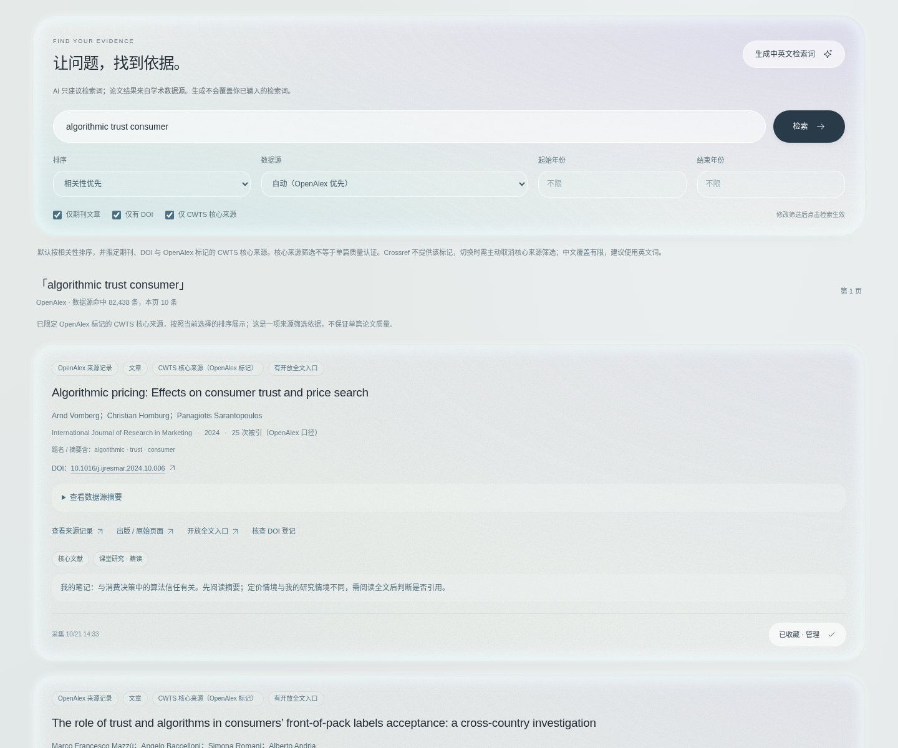

### DOI 登记核查

同一论文的题名一致，但 OpenAlex 与 Crossref 的年份不同，页面明确提示核对版本；不改造来源字段，不声称读过全文。

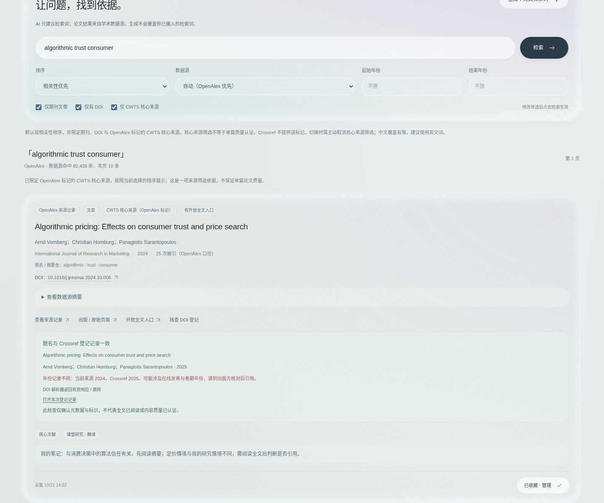

### 按研究、分类与笔记整理

自建分类、一篇多分类、独立阅读笔记与收藏内搜索。研究之间不混放；删除分类保留论文与笔记。

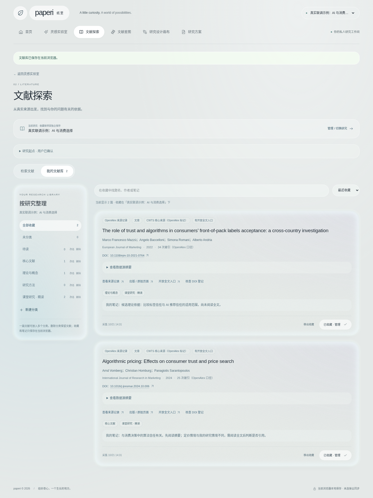

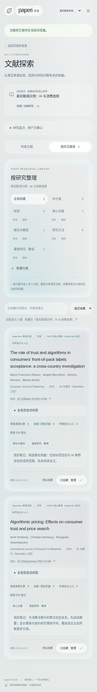

### 收藏窗口与 AI 检索词

AI 只生成中英文词语建议，文献来自真实来源。建议不会自动覆盖检索输入。

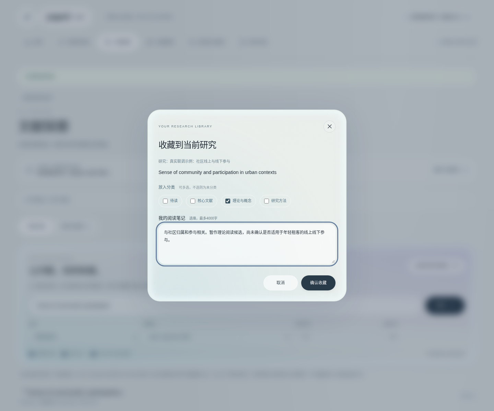

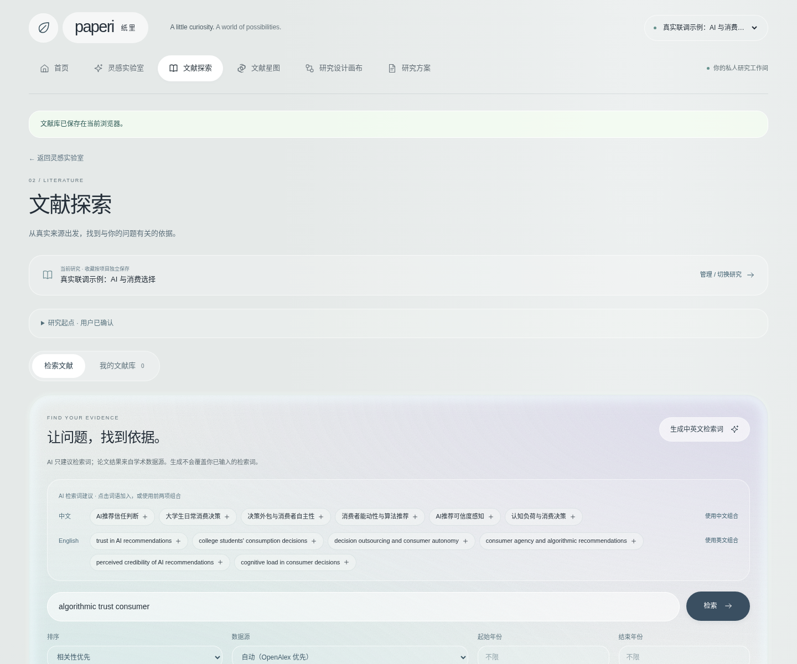

[查看阶段 3 真实验收与三篇 DOI 抽查](STAGE3_ACCEPTANCE.md) · [怎样检索和整理](LITERATURE.md)

下方保留阶段 1/2 的历史截图。

## 真实 AI 运行结果（2026-10-21）

两个不同主题及一次连续追问均收到 DeepSeek 真实回复，各有 3 个候选方向；研究种子编辑、采纳、刷新恢复和项目隔离通过。以下项目明确标记为联调示例，AI 建议仍需核实，不是产品预置内容。

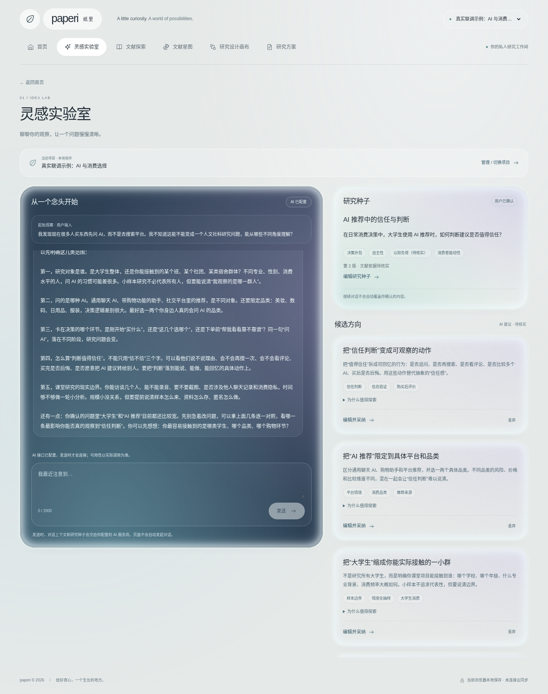

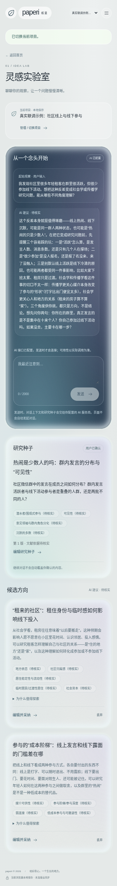

[查看完整真实验收记录](LIVE_AI_ACCEPTANCE.md)。下方保留了首页与接入准备时的界面截图；其中「AI 待连接」是当时未配置接口的历史状态。

## 桌面首页

1440 像素宽度。右侧展示真实项目区的空状态；底部数字仅为研究环节序号。

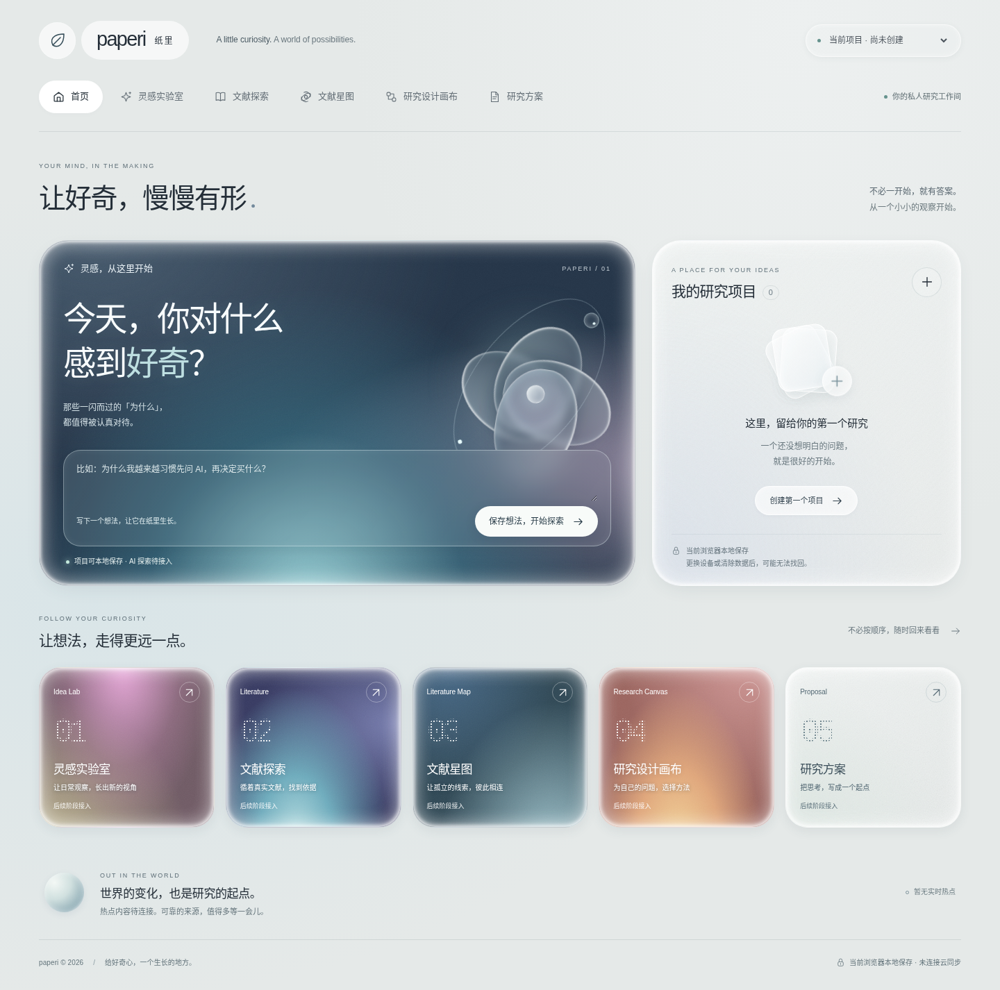

## 磨砂材质细节

主卡片与彩色入口的实际浏览器局部截图，可查看自然晕染、磨砂边缘及细线。文字不参与模糊。

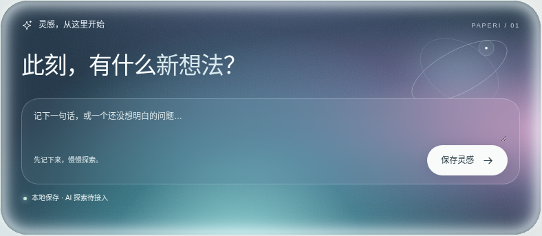

## 工作区页面

灵感实验室支持对话、候选方向与研究种子。此处保留接入准备时未配置 AI 的截图；最新真实回复见上方。截图中的「界面示例（手动输入）」与研究种子仅由截图流程手动填写，**不是 AI 返回，也不是产品预置项目**；新浏览器首次打开仍为空。

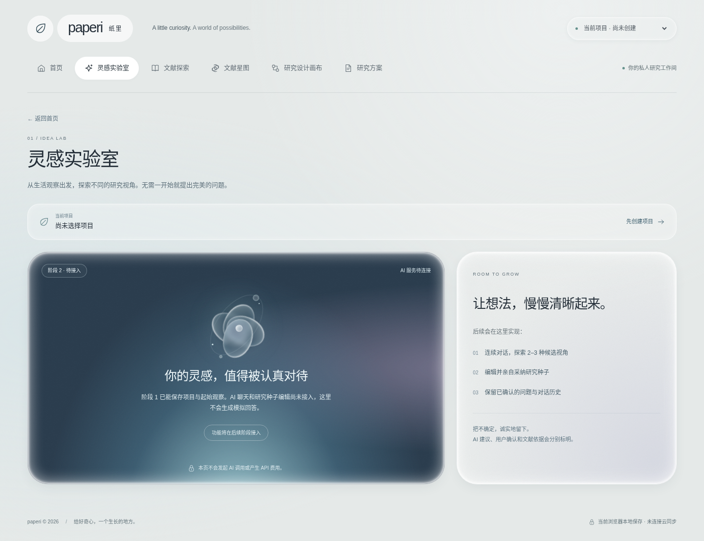

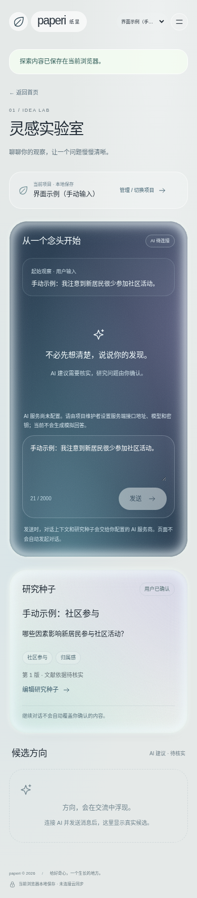

## 手动编辑研究种子

无需 AI 接口即可填写、保存和编辑。已有种子时，采纳新候选需要明确确认替换。

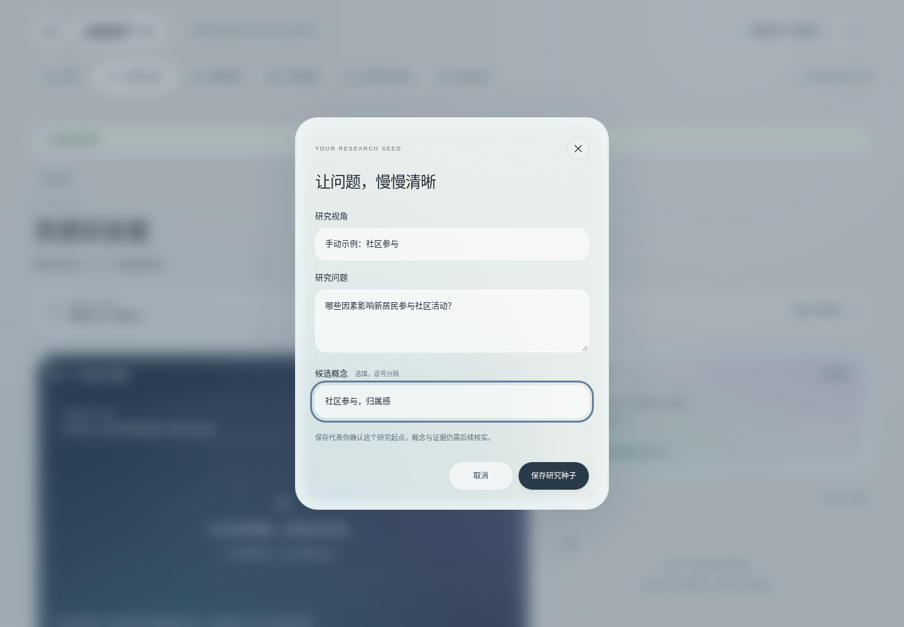

## 创建项目弹窗

支持键盘焦点、取消、名称校验和真实本地保存。

## 手机首页

390 像素宽度。

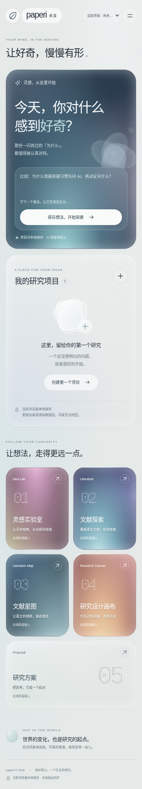

## 手机导航与业务页面

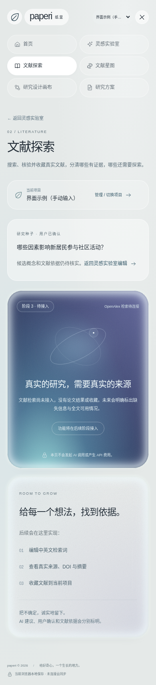

## 平板首页

768 像素宽度。

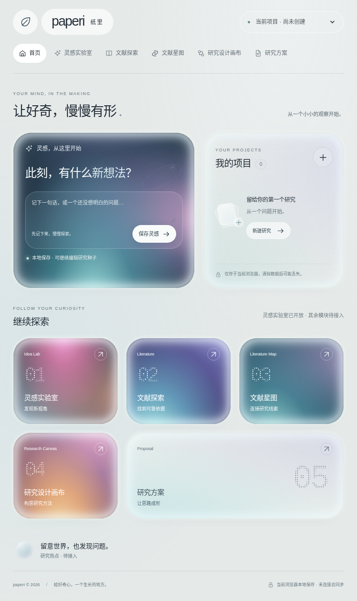

## 验证与代码

当前代码已通过 TypeScript、lint、build 和 37 项自动测试，包括项目回归、四种宽度、研究种子、对话持久化与错误保护，分类收藏、真实源适配器参数与失败保护，以及本地测试服务上的 HTTP 适配器验证。测试数据与生产界面隔离，不代表真实 AI 的质量验收。

当前云环境的真实 AI 已验收。其他运行环境可按 [AI 接口配置说明](AI_SETUP.md) 配置。

[设计说明](DESIGN.md) · [完整测试记录](TEST_RESULTS.md) · [运行说明](../README.md)

代码位于 `codex/paperi-stage1` 分支，可通过分支页面的 Code → Download ZIP 下载。当前没有公开部署网站。
